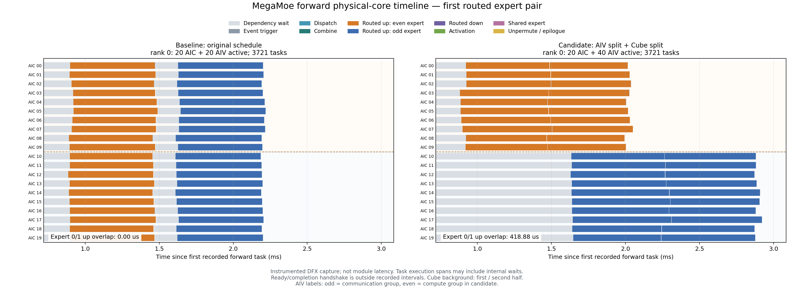
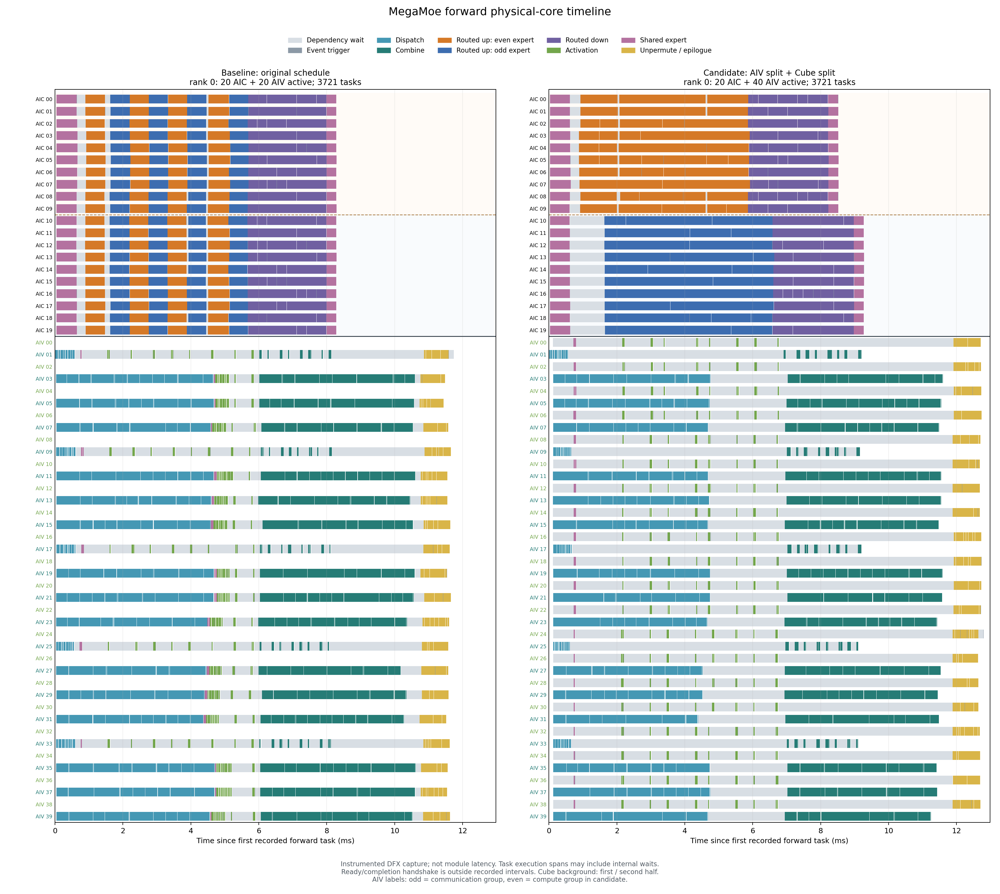

# MegaMoe Vector / Cube 分组调度实验报告

实验日期：2026-11-10。发布分支：`exp/megamoe-core-partition-20261110`。范围：permute / unpermute / shared expert 六项融合全部开启后，测试前向 Vector 通信/计算分组与 Cube 专家 up 分组的收益。

本次实验已经完成构建、正确性、性能、显存和内部 DFX 验证。**当前代表性形状下，同时启用两种分组没有加速：前向耗时增加 6.24%，完整前反向耗时增加 2.50%；allocator 显存峰值下降 0%。建议继续使用原调度，实验代码与本报告发布到独立分支，不并入现有 PR。** 这个结论只适用于下述形状和本次实现，不能推广为所有形状或所有半核 tiling 方案都无收益。

## 1. 对照到底是什么

这里的 baseline 是 PR #12 已整合的 MegaMoe 原调度，permute、unpermute、shared expert 的前向和反向六个开关均为开启。它不是未整合实现，也不是外部单独计算 shared expert 的路径。因此，本报告衡量的是在现有融合实现之上修改核调度的增量，不替代之前的融合收益报告。

四种模式使用同一个候选原生二进制、同一公共自动 token 接口、同样的算子图、输入、权重、路由、精度和训练语义；仅改变前向任务分配。另用冻结的原 PR 二进制做了精度与计时校准。

| 模式 | 前向 Vector 分配 | routed expert up 的 Cube 分配 |
| --- | --- | --- |
| baseline | 20 个奇数 AIV 执行通信与计算混合队列 | 20 个 Cube 核共同执行一个专家 |
| vector | 全部 40 个 AIV：20 个奇数核通信，20 个偶数核计算 | 保持 baseline |
| cube | 保持 baseline | Cube 0–9 执行本地偶数专家，10–19 执行其后一个专家 |
| both | 同 vector | 同 cube |

通信队列包含 Dispatch / Combine 的 SHMEM put/get；计算队列包含 shared SwiGLU、routed SwiGLU、weighted unpermute 与终止任务。Cube 分组只作用于 routed up，不改变 routed down、shared up/down 和反向队列。每对相邻本地专家分别交给两组 Cube，奇数个专家时最后一个仍走原全核路径。

**本次保留每专家原有的 20 个逻辑 GMM 分块，由 10 个物理核分两轮处理。** 这让数学分块、任务总数、事件阈值和累加顺序保持不变，但还不是重新生成“每专家只有 10 个逻辑任务”的专用 tiling。物理核的 scratch / tiling 副本身份仍为物理核 ID，逻辑 GMM core index 只用于确定本次计算分块，避免两个专家共享可变 scratch。

实验选择器只存在于独立实验分支：

```bash
export HP_MEGA_MOE_CORE_PARTITION=baseline  # baseline / vector / cube / both
```

它不增加公共 API 参数，不改变自动 token 管理。应在创建模块及其运行计划前设置，比较各模式时使用新进程。

## 2. 配置与测量口径

| 项目 | 本次取值 |
| --- | --- |
| 硬件 | Ascend 910B3，物理卡 0、1、2、3，EP=4 |
| 核数 | 运行时探测每卡 20 Cube / 40 Vector |
| token | 每 rank T=4096；全局输入 token=16384 |
| 形状 | H=5120，routed I=1792，shared I=1792，E=32，K=8 |
| 专家分布 | 每 rank 8 个专家；均衡路由，每个源 rank 向每个专家发送 1024 行，每专家汇集 4096 行 |
| 数据类型与通信 | BF16，push，初始容量系数 1.5 |
| 融合与训练 | 六项融合全开；forward + 完整 backward，无 optimizer step |
| 软件 | CANN 9.1.0-beta.3，Python 3.11.15，torch 2.7.1+cpu，torch_npu 2.7.1.post4 |
| 环境隔离 | 新建实验 venv，只读继承既有 CANN 9.1 专用 conda；未修改既有环境 |

核心数据流保持为 routed Dispatch → GMM1/up → SwiGLU → GMM2/down → Combine → weighted unpermute，以及 shared up → shared SwiGLU → shared down；最后沿现有融合边界合入输出。本次没有新建中间张量或改变缓冲区生命周期。

主性能来自额外确认轮：**预热 20 次，正式 100 次**，顺序为 baseline_before → both → cube → vector → baseline_after。每个模式新建进程，固定种子与配置。输入、权重和路由构造复用现有 `tests.torch._test_mega_moe`。

- NPU Event 包围公开模块的前向、反向和完整 F+B，并另记同步后的 F+B 墙钟。计时包含这次模块调用在设备队列中的执行及提交间隙，不是裸 megakernel 的单核执行时间，也不是完整 Transformer 训练步。
- 主聚合先计算每个 rank 的 mean / median，再在 4 个 rank 间取 MAX；原始逐 rank 样本和“逐样本 MAX 后统计”的辅助口径均保留。分别取 MAX 的前向、反向中位数不能直接相加来重构完整 F+B 中位数。
- 确认轮运行期间每次 `npu-smi` 查询后间隔约 0.4 秒继续采样，每个作业保存 23–25 次设备进程记录；未采到额外占用所选卡的进程。这是采样证据，不能排除所有短暂进程、CPU 或系统波动。
- 性能采样关闭 DFX；DFX 另外采集，不能把其内部窗口当作模块性能，也不能用不同采样方式的数字相减来量化前后处理成本。
- 显存由独立进程在验证、预热、清除梯度并同步后重置 allocator peak，测量 3 次完整 F+B。报告为稳态训练 F+B 的 rank-max 绝对峰值，不是独立前向或独立反向峰值，也不是整张卡的全部 HBM 占用。

## 3. 主性能结果

以下均为毫秒；变化比例为 `(候选 / baseline_before - 1) × 100%`，正数表示耗时增加。

| 模式 | 前向 median | 反向 median | F+B median | 前向耗时变化 | F+B 耗时变化 |
| --- | ---: | ---: | ---: | ---: | ---: |
| baseline_before | 14.93683 | 18.12233 | 33.02989 | — | — |
| vector | 15.01469 | 18.05344 | 33.07061 | +0.52% | +0.12% |
| cube | 15.91879 | 17.96549 | 33.93840 | +6.57% | +2.75% |
| both | 15.86854 | 17.96640 | 33.85459 | **+6.24%** | **+2.50%** |
| baseline_after | 14.96949 | 18.12896 | 33.10141 | +0.22% | +0.22% |

| 模式 | 前向 mean | 反向 mean | F+B mean | 同步墙钟 F+B median |
| --- | ---: | ---: | ---: | ---: |
| baseline_before | 15.03048 | 18.16102 | 33.13318 | 33.22685 |
| vector | 15.24087 | 18.09925 | 33.22934 | 33.30520 |
| cube | 16.00012 | 18.01251 | 34.01263 | 34.10454 |
| both | 16.05242 | 18.03456 | 34.08287 | 34.01661 |
| baseline_after | 15.12131 | 18.14307 | 33.20963 | 33.30859 |

**Vector 单独分组在本轮基本持平。** 它的 F+B 差异为 0.12%，小于前后 baseline 的 0.22% 漂移，不能据此宣称稳定加速或稳定退化。Cube 分组及 both 则都表现出前向明显变慢；反向调度未变，约 0.9% 的反向差异不能归因于反向算法优化。当前证据支持保留原调度。

辅助离散度：对每次样本先取 4 rank MAX 后，F+B 标准差分别为 baseline_before 0.43821、vector 0.80916、cube 0.55089、both 0.86625、baseline_after 0.65181 ms。这与主表“先按 rank 统计后取 MAX”是不同口径，仅用于观察波动。

可核查原始数据：[汇总与验证](verified-results.json)、[确认轮](confirmation/)、[前基线](confirmation/baseline_before/result.json)、[both](confirmation/both/result.json)、[后基线](confirmation/baseline_after/result.json)。

## 4. 显存结果

| 模式 | allocated 峰值 MiB | reserved 峰值 MiB | allocated 峰值增量 MiB | SHMEM heap / rank MiB | 峰值下降比例 |
| --- | ---: | ---: | ---: | ---: | ---: |
| baseline | 2204.41113 | 2282.00000 | 1646.38623 | 642.00000 | — |
| vector | 2204.41113 | 2282.00000 | 1646.38623 | 642.00000 | 0.00% |
| cube | 2204.41113 | 2282.00000 | 1646.38623 | 642.00000 | 0.00% |
| both | 2204.41113 | 2282.00000 | 1646.38623 | 642.00000 | 0.00% |

MiB=2²⁰ 字节。绝对 allocated 峰值均为 2,311,492,608 字节；reset 前 allocated 基线为 585,131,520 字节，因此增量为 1,726,361,088 字节。reserved 是分配器保留空间；SHMEM 单独报告，不用它与 allocated 简单相加来冒充实测整卡峰值。

结果与改动范围一致：本次只是重排任务、分配核和调整握手，没有减少激活、梯度、输出或 SHMEM 的存储，也没有改变缓冲区复用。启用更多核不会自动减少这些张量，所以当前实验没有显存收益；它也没有造成已测 allocator 峰值增加。

## 5. DFX 证实了什么，为什么没有加速

### 5.1 核划分确实执行了

实际 trace 显示 baseline 使用 20 个 Cube 与 20 个奇数 Vector；vector / both 使用全部 40 个 Vector，其中奇数核仅执行通信，偶数核执行激活和归并。both 的首个本地专家 up 落在 Cube 0–9，第二个落在 Cube 10–19。rank 0 的两个专家实际任务执行（Compute）区间有 **418.88 μs 重叠**，不是仅在 host 队列上重排。



图中左右分别为 baseline 与 both；横轴以各自该次前向首个记录为零点，单位 ms。颜色区分专家，等待条为已记录的依赖等待。图源为确认轮之后单独采集的 `monitored_profile/`，不是计时样本。

### 5.2 静态分半后，第二个专家没有提前开始

| rank | 第二个本地专家首次 Compute：baseline → both，ms | 首个本地专家最后 Compute 结束：baseline → both，ms | both 第二半组最长依赖等待，ms |
| --- | ---: | ---: | ---: |
| 0 | 1.61032 → 1.63092 | 1.48924 → 2.04980 | 1.02066 |
| 1 | 1.54430 → 1.68636 | 1.56896 → 2.05604 | 1.12274 |
| 2 | 1.47342 → 1.64684 | 1.43224 → 2.02650 | 1.02066 |
| 3 | 1.58918 → 1.61388 | 1.46814 → 2.00020 | 1.02068 |

四个 rank 都呈现同一现象：第二半组仍需等待对应专家的依赖完成，首次执行没有提前；第一半组可用资源减半，首个专家反而更晚完成。DFX 直接测到的是等待结束和 Compute 时间，不是网络数据到达的硬件计数器。结合任务依赖，这支持“后一个专家的就绪时序限制了两组并行”的解释，而不需要猜测 cache 效果。baseline 也允许不同 worker 的推进偏差，例如 rank 1 首对专家存在 0.02466 ms 的小幅重叠，不能把原调度误解为所有核之间都有绝对全局串行屏障。

本实现保留 20 个逻辑分块，10 核分两轮处理；它不能享受专用 10-way tiling 可能减少的单专家重复初始化与解码开销。但对一对专家而言，不能说每个物理核的调用次数比 baseline 翻倍：两种方案都需要每核处理两次逻辑任务。当前结论是实际重叠不足以弥补资源分半和等待，不是已经证明某一种初始化开销是主瓶颈。

### 5.3 Vector 分组缩短了激活拖尾，但没有改变最后的依赖链

仅 Vector 分组的独立 DFX 捕获中，rank 0 的 shared SwiGLU 计算跨度从约 0.695–4.765 ms 缩短为 0.751–0.832 ms，说明将计算从通信队列分离确实让共享激活更早完成。

但 shared down 原本就早于最终 Combine 完成：同一次捕获中 baseline / vector 的 shared down 结束为 8.362 / 8.179 ms，本地发出 Combine 的末尾为 10.688 / 10.527 ms，仍有约 2.3 ms 间隔。因此，不能把 shared down 简单认定为最终输出的关键拖尾。主要后段约束仍沿 routed GMM2 → Combine → weighted unpermute；共享激活提前，并没有等量缩短模块总耗时。

通信组和计算组各为 20 核，各阶段自身并行度没有从 20 翻倍到 40；增加的是两类工作的并发机会。Cube 队列仍维持 shared up → routed up → routed down → shared down 的阶段顺序，单独增加 Vector 核并未缩短矩阵乘本身。

上述 Vector 数字来自初轮 `measurements/r0/profile_*` 的单次内部捕获，与确认轮 both 图是不同 capture。它们仅解释队列行为，不作为稳定加速幅度。详细数据见 [Vector 分析](dfx_vector/分析摘要.md)。



全图同时列出 20 Cube / 40 Vector 的物理 lane；baseline 的偶数 Vector 没有任务。其他 rank 的 PNG、SVG 和逐核数据见 [DFX 图目录](dfx_figures/) 与 [机制摘要](dfx_figures/机制摘要.md)。

### 5.4 读图边界

- 共 24 份 trace、48 个前/反向检查通过。各模式每 rank 前向为 3721 个唯一 Compute task（360 AIC + 3361 AIV，含 1 个 terminate）；反向为 4497（720 AIC + 3777 AIV）。无丢失、无重复、droppedRecordCount=0，详见 [完整性检查](dfx-completeness.json)。
- 各核累计 Wait 是“核时间”，启用更多核后更早开始等待会增加累计值，不能把它求和当作模块墙钟损失。
- weighted unpermute 的 Compute 区间内部还包含对本地通信读完成的等待；GMM 的 Compute 也包含内部流水握手。它们不等于纯算术时间。
- 现有 recorder 在 `WaitForDeviceReady` 之后开始、在 `CompleteDeviceReads` 之前结束。ready / completion 没有被采集；图中的 entry skew 只表示握手后的记录起点偏差。
- 不能把带 DFX 的约 12 ms 内部窗口与无 DFX 的约 15 ms 前向模块 Event 当作同一边界，或据此直接推算前后处理开销。

## 6. 正确性与实现检查

| 验证 | 结果与覆盖 |
| --- | --- |
| host 任务、事件与布局 | 800 个有效配置、2080 个 rank 配置通过；160 个不支持的单 Cube 分组配置正确拒绝 |
| host 反向隔离 | 64 个 case × 4 模式，反向 runtime 字节完全一致 |
| 原有相关回归 | 36 tests、301 subtests 通过 |
| 设备重复精度 | small 与 representative 的 4 模式，另加 small pull 的 vector / both，共 10 case × 4 rank × 3 repeats × 7 张量=840 项精确一致检查通过 |
| 冻结旧二进制对照 | 原 PR 二进制与实验 binary 的 baseline 共 84 项输出/梯度 SHA 完全一致 |
| 构建与 DFX | 前反向原生产物构建通过；24 份 trace 的任务完整性通过 |

7 类张量为 output、输入梯度、路由权重梯度，以及 routed up/down、shared up/down 的参数梯度。要求 `torch.equal`、全部有限、max_abs=0。此次是确定性调度回归，不代替已有独立数学 oracle 的测试；实机形状仅覆盖上述 small / representative，不能声称所有动态形状均已实测。

small 为 T=128、H=5120、routed I=128、shared I=1792、每 rank 2 个专家、K=2。host 矩阵还检查队列覆盖、事件可推进性、DFX 容量、L1 物理核映射、64 字节 header 序列化及 completion 计数。Vector 分组的 pull completion 从原 40 个参与核调整为 60（20 Cube + 40 Vector），避免仅启动更多核而遗漏结束握手。

代码相对基线为 12 个文件，+214 / −16 行。主要改动是两个私有队列变换器、前向启用入口、GMM 逻辑块编号、runtime header 标记、Vector worker 分发以及 DFX/L1 核映射。零标记仍走原 worker 路径；没有改变公共接口或反向任务图。

## 7. 后续方向与本次决策

当前保持 baseline。Vector 单独分组可作为后续研究基础，但本轮没有稳定模块加速；Cube 静态分半和 both 暂不进入 PR。

更值得验证的下一步是按专家或 tile 的实际就绪顺序派发工作，或优先推进第二个专家的 Dispatch，让第二半组尽早拿到可计算数据，而不是固定等待专家编号。另一个独立变量是专用 10-way GMM tiling：同步调整每专家任务数、GMM coreNum / usedCoreNum、事件阈值和专家解码，同时保留 20 份物理 scratch，不能简单把全局 Cube 核数改为 10。两者都尚未实现和实测，应分别验证，不能把潜在收益计入本报告。

## 8. 复现与分支交付

- 基线：`45599d6be3aaf9b6d73178b14bf24dac028e6bfd`。
- 实验提交：`54b0ea590f47f46f83c1018fbdabbb98756f8355`，分支 `exp/megamoe-core-partition-20261110`。
- 本分支的原生源码与已测提交 `54b0ea5` 一致；后续提交只整理实验报告、复现脚本和证据。原始 JSON 保留执行环境与原生产物的 provenance，便于追溯。
- 报告及复现材料位于 `experiments/megamoe-core-partition-20261110/`。实验环境使用独立 venv，只读继承既有 CANN 9.1 conda。
- 构建：`bash build.sh --soc-list ascend910b --jobs 24`，退出码 0；元数据见 [native-build-info.json](artifacts/native-build-info.json)。
- wheel：[匹配本次实验的原生包](artifacts/hyper_multicore-0.1.0.dev0+pt.2.7.1.post4-cp311-cp311-linux_aarch64.whl)，SHA256=`256a3167975920c4a08e3ef396d90372ace5e7ff993a02557ca5f3c266a4113e`。
- 基线与实验代码均可通过上述 Git 提交恢复；重复的本地 Git bundle 和构建日志不纳入本目录。本次发布到新的实验分支，未修改现有 PR 分支。
- 原始 DFX trace 压缩保存在 [dfx-traces.tar.gz](artifacts/dfx-traces.tar.gz)，包含初轮四模式和确认轮两模式的 24 份 JSON；[原始 trace 校验值](artifacts/dfx-trace-sha256.json) 用于核验解压前后的数据一致性。

复现须先确认 4 张卡空闲，激活适配 CANN 9.1 的独立 Python 环境并 source 对应 CANN `set_env.sh`，然后构建本分支。`run_monitored.py` 包含空闲检查与占用采样；没有空闲卡时等待，不中断其他作业。脚本会加载目标仓库的已构建 vendor。确认轮入口见 [run-confirmation.sh](run-confirmation.sh)：

```bash
# 在本仓库根目录执行；Python 需已配置 torch / torch_npu。
repo=$(pwd)
python=$(command -v python)
bash experiments/megamoe-core-partition-20261110/run-confirmation.sh \
  "$repo" "$python" 0,1,2,3 /path/to/new-results 62600
```

`/path/to/new-results` 应换成尚无本轮结果的新目录；端口需确认可用。该入口依次运行前基线、both、cube、vector、后基线的 20/100 性能确认，并单独采集 baseline / both 的 DFX。单独运行一种模式或阶段：

```bash
python experiments/megamoe-core-partition-20261110/run_monitored.py \
  "$repo" "$python" 0,1,2,3 both performance /path/to/new-result 62600
```

将 `performance` 换成 `precision`、`memory`、`profile` 可运行其他阶段。底层脚本拒绝覆盖已有 `result.json`。CPU 任务图验证可在仓库根目录运行：

```bash
python3 experiments/megamoe-core-partition-20261110/validate_vector_partition.py --repo .
python3 experiments/megamoe-core-partition-20261110/validate_backward_partition_isolation.py
```

报告中的图片可直接在 GitHub 浏览。要重新绘制原始 DFX，请在本报告目录解压并运行：

```bash
cd experiments/megamoe-core-partition-20261110
tar -xzf artifacts/dfx-traces.tar.gz
python3 analyze_partition_dfx.py \
  --baseline monitored_profile/baseline \
  --candidate monitored_profile/both \
  --output /path/to/new-dfx-figures
```

绘图依赖 Python 的 Matplotlib。解压后的原始 Chrome Trace 位于 `monitored_profile/{baseline,both}/rankN_trace.json` 及 `measurements/r0/profile_*/`；这些 JSON 可供 trace viewer 打开。已提交的 PNG / SVG 已经完成视觉检查，重新绘图使用新输出目录以保留原始证据。

## 附：初轮数据与环境波动

初轮采用预热 10 次、测量 50 次，正序和反序各一次。为保留完整实验记录，数据列于下表；主结论使用后续带占用监控、前后基线的确认轮，不混合平均。

| 轮次 | 模式 | 前向 median ms | 反向 median ms | F+B median ms |
| --- | --- | ---: | ---: | ---: |
| r0 | baseline | 15.00780 | 18.14410 | 33.13998 |
| r0 | vector | 14.89031 | 18.10861 | 33.13858 |
| r0 | cube | 17.12464 | 19.46169 | 36.29043 |
| r0 | both | 15.84585 | 17.93708 | 33.81595 |
| r1 | baseline | 14.88440 | 17.98110 | 33.03420 |
| r1 | vector | 14.80040 | 18.01150 | 32.96850 |
| r1 | cube | 16.78710 | 18.91080 | 36.41450 |
| r1 | both | 16.75980 | 18.95830 | 38.13010 |

初轮部分长尾集中在 rank 0/1，且未修改的反向也明显变慢；both r1 有 11/50 个前向样本超过 20 ms。所有逐样本 F+B 与 full 的差异小于 0.000003 ms，没有发现计时字段拼错。初轮没有全程进程监控，无法确定长尾来源，不能把 38.13 ms 相对 33.03 ms 的全部差值都归因于核划分。确认轮未采到其他 NPU 进程，但这也不能倒推证明初轮一定由其他作业造成。

冻结原 PR 二进制的两次 10/50 校准 F+B 中位数为 33.29439、33.14146 ms，前向分别为 15.29586、14.98645 ms；与实验 binary 的 baseline 处于相近范围。此校准用于排查基线框架变化，主模式比较仍使用同一个候选 binary。
