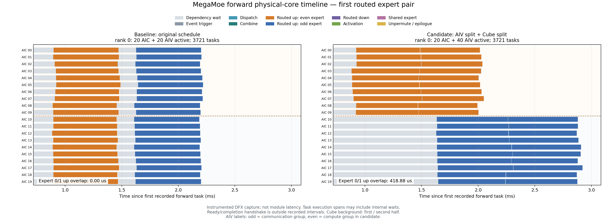
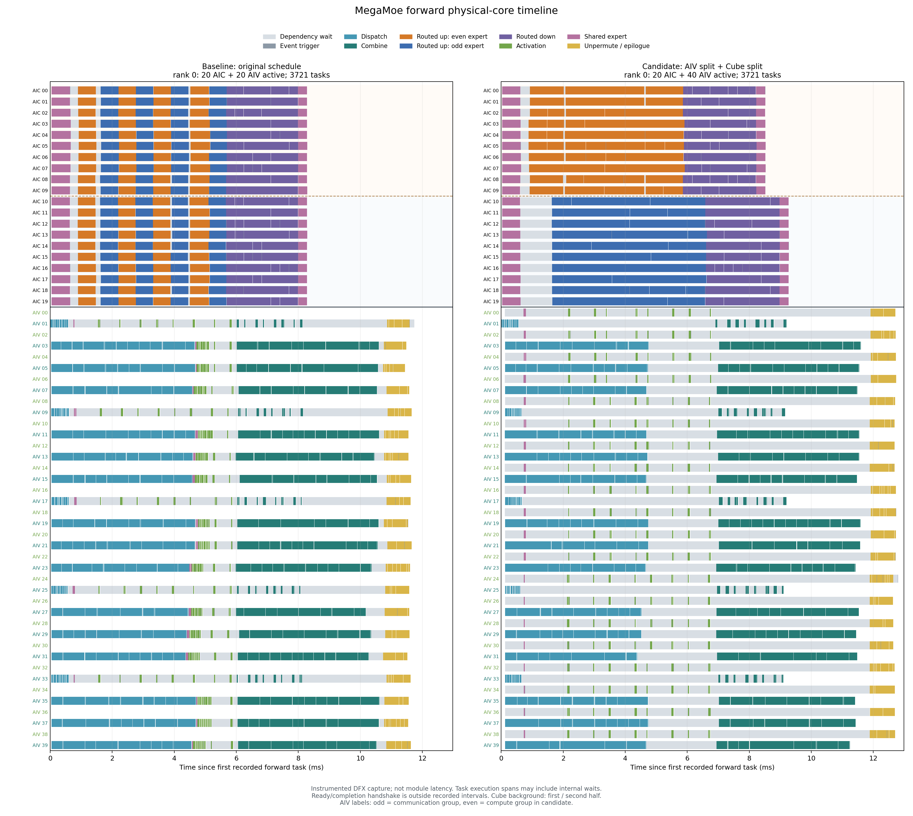

# 受控 DFX 内部流水与分核机制分析

本节只解释调度机制；正式性能结论使用 `confirmation/` 中独立进程、20 次预热、100 次采样的无 DFX NPU Event 结果。这里的时间来自 `monitored_profile/baseline` 和 `monitored_profile/both` 各一次训练态前向内部记录，不能替代模块耗时或据此计算正式加速比。两个 capture 均使用提交 `54b0ea5` 的同一套二进制，baseline 是原调度，both 是 Vector 通信/计算分核与 Cube 专家对分核同时开启；前反向 permute、unpermute、shared expert 六项融合均开启，反向调度未变。

形状：每 rank T=4096、H=5120、I=1792、shared I=1792、E=32、K=8、EP=4、BF16、push dispatch、固定 balanced route；910B3 每卡 20 Cube / 40 Vector，设备 0–3。所有图共用 baseline/candidate 横轴，并以各 rank 首个前向记录为零点。跨 rank 时钟没有做网络级对齐。

## 实际核绑定和任务完整性

每条 Compute 对应一次 `ExecuteComputeKernel` 调用。以下数量同时核对 runtime 任务队列、唯一 task ID、AIC/AIV 类型与终止任务，并非只检查重复数为零。

| Rank | 模式 | 唯一前向 task | AIC / AIV task | terminate | 活跃 Cube / Vector | 丢记录 / 重复 | 核角色匹配 |
|---:|---|---:|---:|---:|---:|---:|---|
| 0 | baseline | 3721 / 3721 | 360 / 3361 | 1 | 20 / 20 | 0 / 0 | 通过 |
| 0 | both | 3721 / 3721 | 360 / 3361 | 1 | 20 / 40 | 0 / 0 | 通过 |
| 1 | baseline | 3721 / 3721 | 360 / 3361 | 1 | 20 / 20 | 0 / 0 | 通过 |
| 1 | both | 3721 / 3721 | 360 / 3361 | 1 | 20 / 40 | 0 / 0 | 通过 |
| 2 | baseline | 3721 / 3721 | 360 / 3361 | 1 | 20 / 20 | 0 / 0 | 通过 |
| 2 | both | 3721 / 3721 | 360 / 3361 | 1 | 20 / 40 | 0 / 0 | 通过 |
| 3 | baseline | 3721 / 3721 | 360 / 3361 | 1 | 20 / 20 | 0 / 0 | 通过 |
| 3 | both | 3721 / 3721 | 360 / 3361 | 1 | 20 / 40 | 0 / 0 | 通过 |

both 的 AIV 1、3、…、39 只执行 Dispatch/Combine，AIV 0、2、…、38 执行激活、unpermute/epilogue 和控制任务。全部 40 个 Vector 均有记录，单种职责仍为 20 个 worker，并不等于每个阶段获得了双倍并行度。baseline 使用 20 个奇数 AIV 混排上述任务。

全部 4 个 rank 的每个路由专家 up 都保持 20 个逻辑 task。baseline 每个专家分配给全部 20 Cube、每核 1 个 task；both 将本地偶数专家分配给 Cube 0–9，奇数专家分配给 Cube 10–19，每核顺序执行 2 个逻辑 task。每 rank 路由 up 仍为 160 个 task，没有减算或漏算。

## 两个专家确实重叠，但第二个专家并未提前开始

下表列出每个 rank 的第一个本地专家对。时间为 DFX 相对时间，单位 ms；首/末指所有物理核上的第一条/最后一条 Compute 边界。

| Rank / 全局专家 ID | 第一个专家 baseline 首→末 | 第一个专家 both 首→末 | 第二个专家 baseline 首→末 | 第二个专家 both 首→末 | both 第二专家最大依赖 Wait | both 重叠 / 较短执行区间并集 |
|---|---:|---:|---:|---:|---:|---:|
| 0 / 0、1 | 0.88582→1.48924 | 0.88314→2.04980 | 1.61032→2.21852 | 1.63092→2.92168 | 1.02066 | 0.41888 / 35.90% |
| 1 / 8、9 | 0.96454→1.56896 | 0.88752→2.05604 | 1.54430→2.15394 | 1.68636→2.96076 | 1.12274 | 0.36968 / 31.64% |
| 2 / 16、17 | 0.83834→1.43224 | 0.84072→2.02650 | 1.47342→2.07990 | 1.64684→2.98560 | 1.02066 | 0.37966 / 32.02% |
| 3 / 24、25 | 0.86810→1.46814 | 0.84698→2.00020 | 1.58918→2.21010 | 1.61388→2.93402 | 1.02068 | 0.38632 / 33.50% |

4 个 rank 都呈现相同趋势：第二个专家首次执行没有提前，第一专家却因分到的 Cube 减半而更晚完成。rank 0 的专家 1 在 1.63092 ms 才进入 Compute，其所属半组最长等待 1.02066 ms；与此同时专家 0 的完成从 1.48924 ms 延后到 2.04980 ms。两者虽出现 0.41888 ms 的真实重叠，仍不足以抵消每专家只使用 10 个物理核的串行 tile 成本。该结论来自核绑定、依赖 Wait 和执行边界，不需要假定 cache 退化。

这里可直接观测的是依赖等待与任务首次执行；它不是网络包到达计数器，不能进一步精确声称某条数据的实际到达时刻。baseline 的 rank 1 存在 0.02466 ms 的小幅专家对重叠，来自不同 worker 的推进偏差，仍然是每个专家分配全部 20 核；不能把 baseline 描述为所有核之间存在绝对全局串行屏障。

## Shared 提前完成未缩短最终依赖链

rank 0 各阶段的第一/最后 Compute 边界如下。阶段彼此重叠，不能把行内跨度或跨核累计时间相加重建模块耗时。

| 阶段 | baseline 首→末（ms） | both 首→末（ms） |
|---|---:|---:|
| Dispatch | 0.00042→4.70680 | 0.00044→4.76032 |
| shared_up_proj | 0.03552→0.66396 | 0.02792→0.64136 |
| shared_swiglu | 0.72636→4.76702 | 0.72122→0.80370 |
| GMM1 | 0.88582→5.69966 | 0.88314→6.63500 |
| SwiGLU | 1.54310→5.92432 | 2.12642→6.78164 |
| GMM2 | 5.66806→7.99766 | 5.85818→8.97976 |
| shared_down_proj | 7.99006→8.28618 | 8.21470→9.27526 |
| Combine | 5.98284→10.62644 | 6.91278→11.60476 |
| WeightedUnpermute | 10.73284→11.65480 | 11.88560→12.73380 |

专用 Vector 计算组使 rank 0 shared_swiglu 的尾部从 4.76702 ms 提前至 0.80370 ms；但 shared_down 仍早于本 rank 最后一个 Combine task 完成。所有 rank 的这段余量均为正：

| Rank | baseline shared_down 末 | baseline Combine 末 | 余量 | both shared_down 末 | both Combine 末 | 余量 |
|---:|---:|---:|---:|---:|---:|---:|
| 0 | 8.28618 | 10.62644 | 2.34026 | 9.27526 | 11.60476 | 2.32950 |
| 1 | 8.27584 | 10.75842 | 2.48258 | 9.28576 | 11.70212 | 2.41636 |
| 2 | 8.22708 | 10.54314 | 2.31606 | 9.87962 | 11.81114 | 1.93152 |
| 3 | 8.24000 | 10.68344 | 2.44344 | 9.31294 | 11.71046 | 2.39752 |

因此不能仅因 shared_down 在 Cube 队列后段才执行，就把它判为最终 join 的瓶颈，或把优先前移它列为已经证实有效的优化。当前较清楚的机制是：shared_swiglu 提前主要增加了共享分支已有的余量；路由 GMM1 的尾部在所有 rank 延后，继而路由 GMM2 和 Combine 更晚完成，最后仍需 weighted unpermute。rank 0 GMM1 尾部 5.69966→6.63500 ms，GMM2 尾部 7.99766→8.97976 ms，Combine 尾部 10.62644→11.60476 ms。

## 依赖和计时边界

- `hyper_multicore/modules/mega_moe/shared_schedule.py:132`、`:189`、`:235` 将共享 down 完成与路由 Combine 信号接到 weighted unpermute 的依赖事件；共享分支上游与 routing 独立。
- 外部 `WaitDependency` 对应输入侧 Combine 信号及 shared down 的 join。`hyper_multicore/ops/hyper_mega_moe/op_kernel/worker_kernel.cpp:244` 在 `ExecuteWeightedUnpermute` 内还等待本 rank outgoing Combine 读完可复用存储，这段等待位于 DFX Compute 区间内。
- 因此少数 rank 的 WeightedUnpermute Compute 可以早于该 rank 最后一个 outgoing Combine 的结束，例如 both rank 2 为 11.60608 ms 对 11.81114 ms。不能把该 Compute 起点直接解释为真正的 unpermute 数学计算开始，也不能用本地 Combine 尾部冒充远端 incoming 完成时间。
- `hyper_multicore/ops/runtime/worker_kernel.h:172` 的入口 ready handshake 位于 `ProcessProfiled` 之前，`:185` 的 completion handshake 位于其后，两者不在图中。entry skew 只是 ready 后进入记录器的偏差，不是 ready handshake 耗时。
- Compute 包住任务处理函数，通信 task 自然包含传输，某些计算 task 包含内部等待；累计 core-time 是所有核时间之和，不是 wall time。新增 worker 提前进入依赖等待会增加累计 wait，不能据此声称设备整体更空闲。
- 本批 trace 可证明任务完整性、实际物理核分工、专家对执行区间重叠与阶段先后；没有 cache/bandwidth 硬件计数器，不能证明性能差异源于缓存或带宽争用。

结合 `confirmation/` 的独立性能结果，本批 DFX 为当前配置继续保留原调度提供了机制解释。若后续再做调度探索，应先验证 readiness-aware 的 Cube 任务分配或按已就绪专家借用另一半空闲核，避免提前把半数核固定在尚未 ready 的专家队列上；这是待验证方向，不是本次已实现的收益。不能用旧批次未充分控制的反向重尾解释本次前向调度机制。

## 文件与复现

- 主图：`rank0_forward_timeline.png/.svg`、`rank0_up_pair_zoom.png/.svg`；rank 1–3 的同名文件也已生成。
- 审计：`dfx_analysis.json` 保留全部 4 rank 的 task、绑定、stage、Wait、区间重叠和原 trace SHA256；`关键阶段.csv` 为关键阶段的可复用数字。
- 输入：`../monitored_profile/{baseline,both}/rank{0,1,2,3}_trace.json`，以及对应 `rankN.json` 和设备占用监控记录。
- 可复现命令：在结果目录运行 `python3 analyze_partition_dfx.py --baseline monitored_profile/baseline --candidate monitored_profile/both --output dfx_figures`，然后 `python3 write_dfx_mechanism_summary.py`。
- 已人工检查 rank 0 全流水、rank 0 首专家对放大图、rank 2 全流水：标题、图例、核标签及说明可读，baseline/candidate 共用横轴，无裁切、文字重叠；SVG 可继续放大。
